# Questions per sheet

Generated by `common/collect.py` from `stimuli/*/spec.json` (the source of truth; DESIGN.md is the original plan).

Each sheet: columns consistent · conflict · no numbers, rows en · tr. Answers are written `en · tr` (one value when both languages agree). Prompts go to the model with the prefix `answer en ` / `answer tr `.

- **from the drawing**: the answer when the marks are read. It is the expected answer on the consistent and no-numbers versions, and the *visual* answer on the conflict version.
- **conflict: from the text**: the answer when the printed numbers of the conflict version are read. For `axis` and `legend` charts this is the correct answer; for `label` and `readout` charts there is no correct answer.
- **no numbers**: ✓ = also asked on the no-numbers version; — = can't be answered from the drawing alone, not asked there.

## s01 · Loaves sold per month (newspaper)

*newspaper page · column bars · mechanism `label` (conflict: no correct answer, only a preference) · 5 questions*

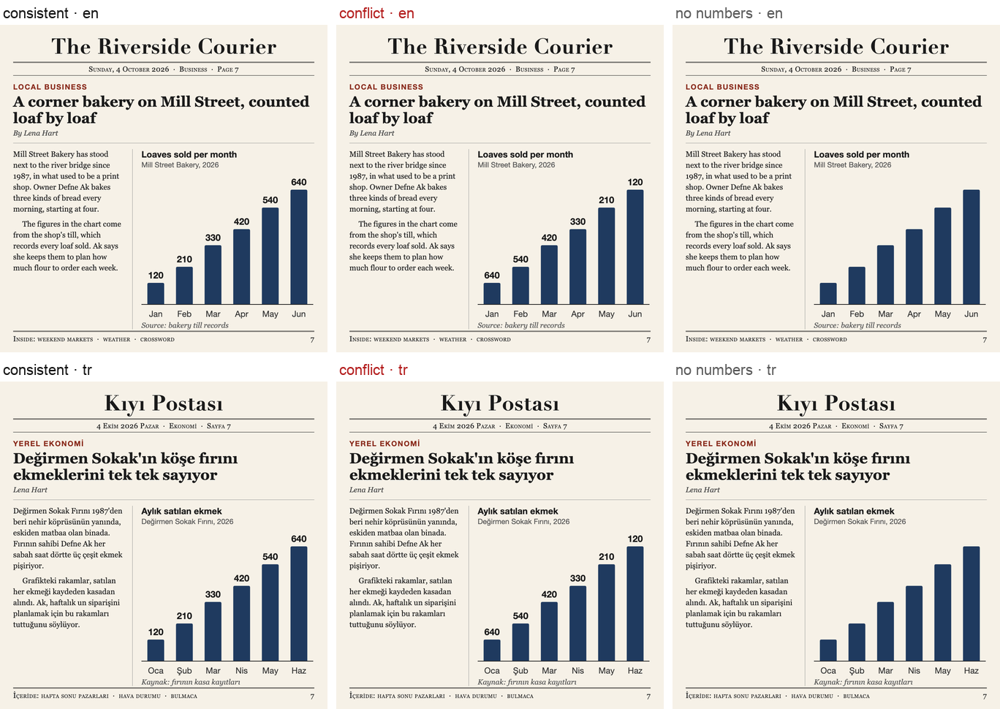

**Conflict:** Bars rise Jan→Jun like a wifi icon; in conflict the printed values fall 640→120.

| # | question (en) | soru (tr) | from the drawing | conflict: from the text | no numbers |
|---|---|---|---|---|:-:|
| q1 | did monthly sales go up or down from january to june? | ocaktan hazirana aylık satışlar arttı mı azaldı mı? | up · arttı | **down · azaldı** | ✓ |
| q2 | in which month were the most loaves sold? | en çok ekmek hangi ayda satıldı? | june · haziran | **january · ocak** | ✓ |
| q3a | were more loaves sold in june than in january? *(pair p1)* | haziranda ocaktan daha fazla ekmek satıldı mı? | yes · evet | **no · hayır** | ✓ |
| q3b | were fewer loaves sold in june than in january? *(pair p1)* | haziranda ocaktan daha az ekmek satıldı mı? | no · hayır | **yes · evet** | ✓ |
| q4 | how many loaves were sold in june? | haziranda kaç ekmek satıldı? | 640 | **120** | — |

## s02 · Bicycle thefts reported per year (news site, dark)

*news-site article page, dark theme · line with markers · mechanism `axis` (conflict: text is the correct answer) · 5 questions*

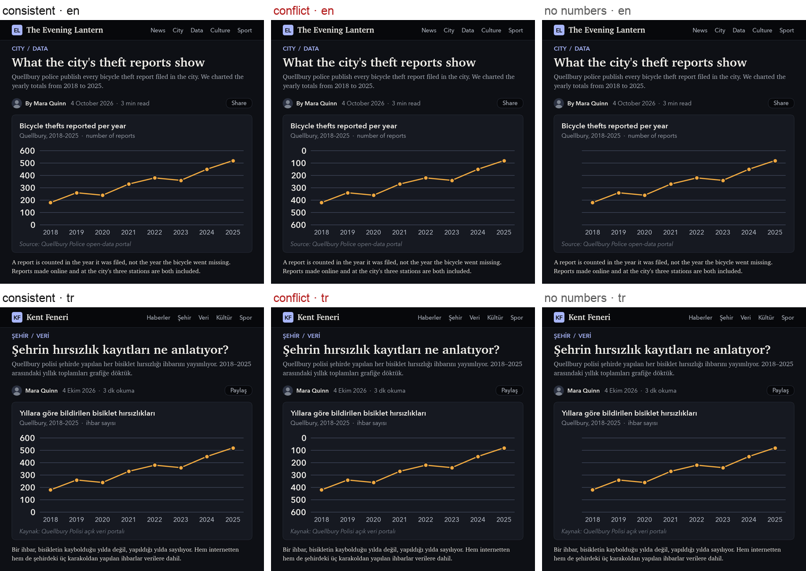

**Conflict:** Line rises 2018→2025 (180→520 on a normal 0–600 axis); in conflict the y tick labels are inverted (0 at top, 600 at bottom), so the same line encodes falling values 420→80. Years, not months: bicycle theft is seasonal, and a Jan→Aug axis would add a prior agreeing with the rising line.

| # | question (en) | soru (tr) | from the drawing | conflict: from the text | no numbers |
|---|---|---|---|---|:-:|
| q1 | did the number of bicycle thefts increase or decrease from 2018 to 2025? | 2018'den 2025'e bisiklet hırsızlığı sayısı arttı mı azaldı mı? | up · arttı | **down · azaldı** | ✓ |
| q2 | in which year were the most bicycle thefts reported? | en çok bisiklet hırsızlığı hangi yıl bildirildi? | 2025 | **2018** | ✓ |
| q3 | in which year were the fewest bicycle thefts reported? | en az bisiklet hırsızlığı hangi yıl bildirildi? | 2018 | **2025** | ✓ |
| q4a | were more bicycle thefts reported in 2025 than in 2018? *(pair p1)* | 2025'te 2018'den daha fazla bisiklet hırsızlığı bildirildi mi? | yes · evet | **no · hayır** | ✓ |
| q4b | were fewer bicycle thefts reported in 2025 than in 2018? *(pair p1)* | 2025'te 2018'den daha az bisiklet hırsızlığı bildirildi mi? | no · hayır | **yes · evet** | ✓ |

## s03 · Smartphone market share (presentation slide)

*corporate presentation slide · donut · mechanism `label` (conflict: no correct answer, only a preference) · 5 questions*

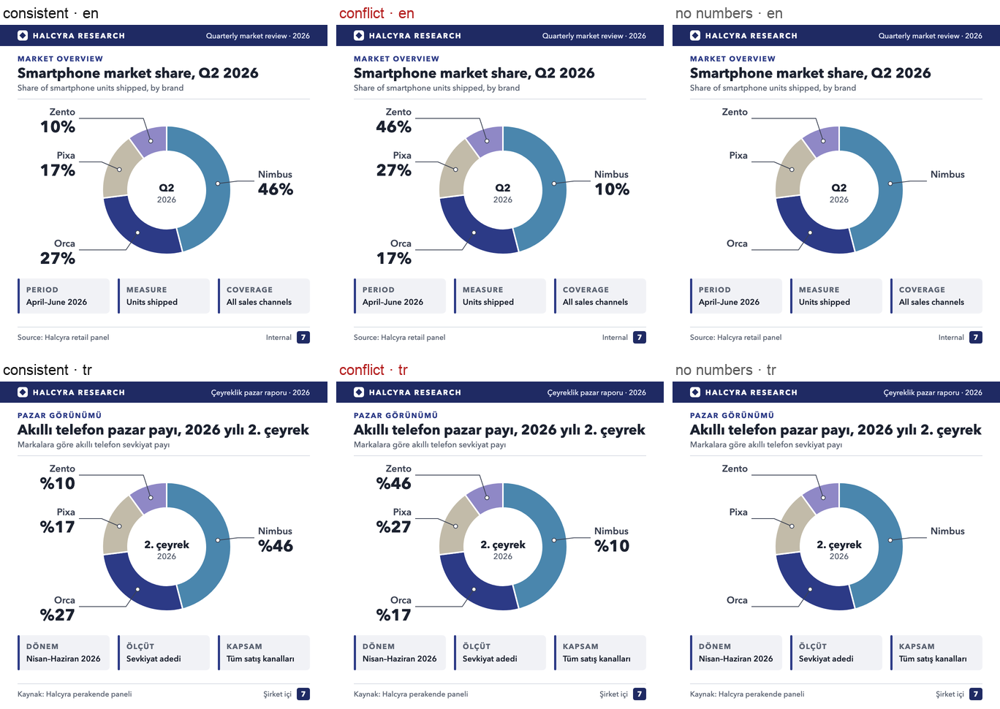

**Conflict:** Slices clockwise from 12 o'clock are Nimbus 46, Orca 27, Pixa 17, Zento 10; in conflict the callouts print the shares reversed (Nimbus 10%, Orca 17%, Pixa 27%, Zento 46%).

| # | question (en) | soru (tr) | from the drawing | conflict: from the text | no numbers |
|---|---|---|---|---|:-:|
| q1 | which brand has the largest market share? | en büyük pazar payına hangi marka sahip? | nimbus | **zento** | ✓ |
| q2 | which brand has the smallest market share? | en küçük pazar payına hangi marka sahip? | zento | **nimbus** | ✓ |
| q3a | does zento have more than a third of the market? *(pair p1)* | zento'nun pazar payı üçte birden fazla mı? | no · hayır | **yes · evet** | ✓ |
| q3b | does zento have less than a third of the market? *(pair p1)* | zento'nun pazar payı üçte birden az mı? | yes · evet | **no · hayır** | ✓ |
| q4 | what is orca's market share? | orca'nın pazar payı yüzde kaç? | 27 | **17** | — |

## s04 · Screen time this week (phone app)

*phone app screenshot, dark UI · horizontal bars · mechanism `label` (conflict: no correct answer, only a preference) · 5 questions*

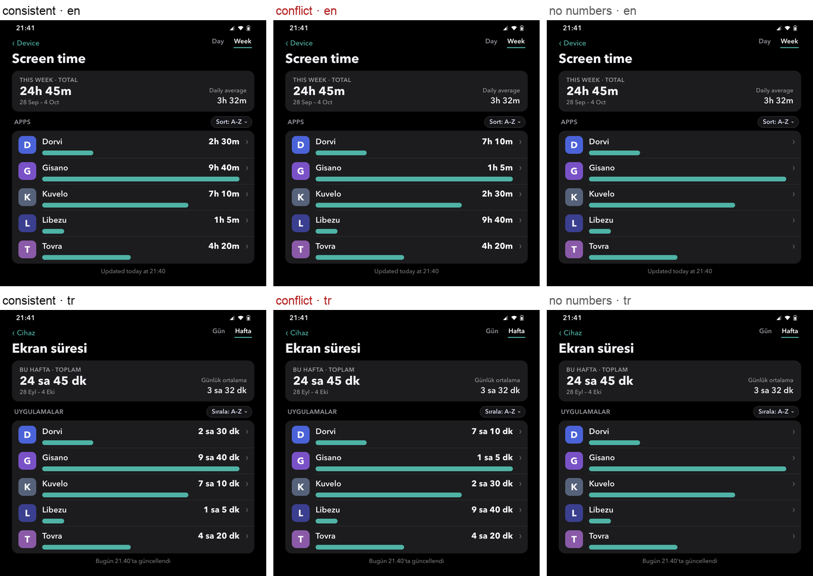

**Conflict:** Rows in A–Z order, stated by a 'Sort: A–Z' chip (Dorvi 2h 30m, Gisano 9h 40m, Kuvelo 7h 10m, Libezu 1h 5m, Tovra 4h 20m); in conflict the printed times are mirrored by rank (Dorvi 7h 10m, Gisano 1h 5m, Kuvelo 2h 30m, Libezu 9h 40m, Tovra 4h 20m). Weekly total 24h 45m is identical in both.

| # | question (en) | soru (tr) | from the drawing | conflict: from the text | no numbers |
|---|---|---|---|---|:-:|
| q1 | which app was used the most this week? | bu hafta en çok hangi uygulama kullanıldı? | gisano | **libezu** | ✓ |
| q2 | which app was used the least this week? | bu hafta en az hangi uygulama kullanıldı? | libezu | **gisano** | ✓ |
| q3a | was dorvi used more than kuvelo this week? *(pair p1)* | dorvi bu hafta kuvelo'dan daha fazla kullanıldı mı? | no · hayır | **yes · evet** | ✓ |
| q3b | was dorvi used less than kuvelo this week? *(pair p1)* | dorvi bu hafta kuvelo'dan daha az kullanıldı mı? | yes · evet | **no · hayır** | ✓ |
| q4 | how long was dorvi used this week? | dorvi bu hafta ne kadar süre kullanıldı? | 2h 30m · 2 sa 30 dk | **7h 10m · 7 sa 10 dk** | — |

## s05 · Trees planted by each school (school poster)

*school poster pinned to a cork board · pictogram (isotype) · mechanism `label` (conflict: no correct answer, only a preference) · 5 questions*

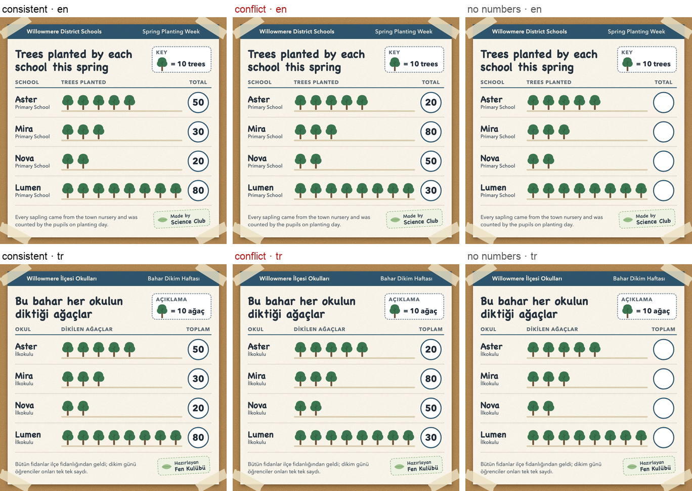

**Conflict:** Icon rows (top to bottom) show Aster 5, Mira 3, Nova 2, Lumen 8 trees (x10); in conflict the printed row totals read Aster 20, Mira 80, Nova 50, Lumen 30.

| # | question (en) | soru (tr) | from the drawing | conflict: from the text | no numbers |
|---|---|---|---|---|:-:|
| q1 | which school planted the most trees? | en çok ağacı hangi okul dikti? | lumen | **mira** | ✓ |
| q2 | how many trees did aster school plant? | aster okulu kaç ağaç dikti? | 50 | **20** | ✓ |
| q3a | did mira school plant more trees than lumen school? *(pair p1)* | mira okulu, lumen okulundan daha fazla ağaç dikti mi? | no · hayır | **yes · evet** | ✓ |
| q3b | did mira school plant fewer trees than lumen school? *(pair p1)* | mira okulu, lumen okulundan daha az ağaç dikti mi? | yes · evet | **no · hayır** | ✓ |
| q4 | which school planted the fewest trees? | en az ağacı hangi okul dikti? | nova | **aster** | ✓ |

## s06 · Noon temperatures (TV weather)

*TV weather broadcast graphic · thermometer fills · mechanism `readout` (conflict: no correct answer, only a preference) · 5 questions*

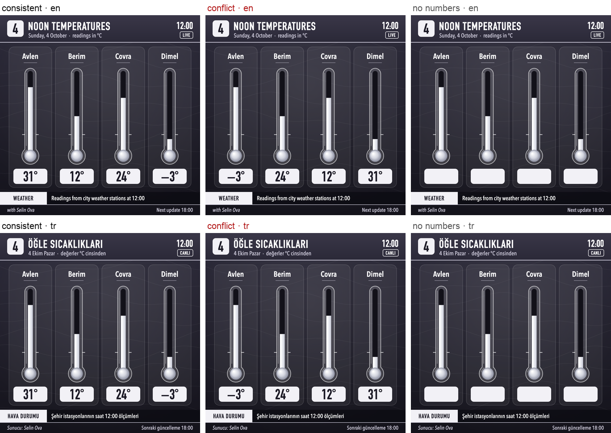

**Conflict:** Mercury columns: Avlen highest, Dimel lowest (just under the 0 °C notch); in conflict the readouts are swapped 31°<->−3° (Avlen<->Dimel, three cards apart) and 12°<->24° (Berim<->Covra).

| # | question (en) | soru (tr) | from the drawing | conflict: from the text | no numbers |
|---|---|---|---|---|:-:|
| q1 | which city is the warmest? | en sıcak şehir hangisi? | avlen | **dimel** | ✓ |
| q2 | which city is the coldest? | en soğuk şehir hangisi? | dimel | **avlen** | ✓ |
| q3a | is it below freezing in avlen? *(pair p1)* | avlen'de sıcaklık sıfırın altında mı? | no · hayır | **yes · evet** | — |
| q3b | is it above freezing in avlen? *(pair p1)* | avlen'de sıcaklık sıfırın üstünde mi? | yes · evet | **no · hayır** | — |
| q4 | what is the temperature in dimel? | dimel'de sıcaklık kaç derece? | -3 | **31** | — |

## s07 · CPU load per server (monitoring dashboard)

*server monitoring dashboard, dark UI, monospace type (Menlo) · semicircle gauges · mechanism `readout` (conflict: no correct answer, only a preference) · 5 questions*

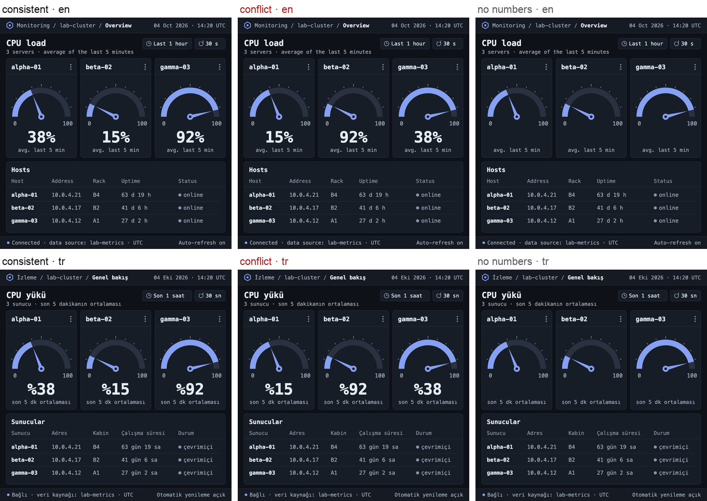

**Conflict:** Needles/fills show alpha-01 38, beta-02 15, gamma-03 92; in conflict the readouts under the gauges say alpha-01 15%, beta-02 92%, gamma-03 38%.

| # | question (en) | soru (tr) | from the drawing | conflict: from the text | no numbers |
|---|---|---|---|---|:-:|
| q1 | which server has the highest cpu load? | cpu yükü en yüksek olan sunucu hangisi? | gamma-03 | **beta-02** | ✓ |
| q2 | which server has the lowest cpu load? | cpu yükü en düşük olan sunucu hangisi? | beta-02 | **alpha-01** | ✓ |
| q3a | is the cpu load of gamma-03 above 80 percent? *(pair p1)* | gamma-03'ün cpu yükü yüzde 80'in üzerinde mi? | yes · evet | **no · hayır** | ✓ |
| q3b | is the cpu load of gamma-03 below 80 percent? *(pair p1)* | gamma-03'ün cpu yükü yüzde 80'in altında mı? | no · hayır | **yes · evet** | ✓ |
| q4 | what is the cpu load of alpha-01? | alpha-01'in cpu yükü yüzde kaç? | 38 | **15** | — |

## s08 · Accuracy of three methods on two benchmarks (photographed paper page)

*photographed page of an academic paper · grouped bars · mechanism `label` (conflict: no correct answer, only a preference) · 5 questions*

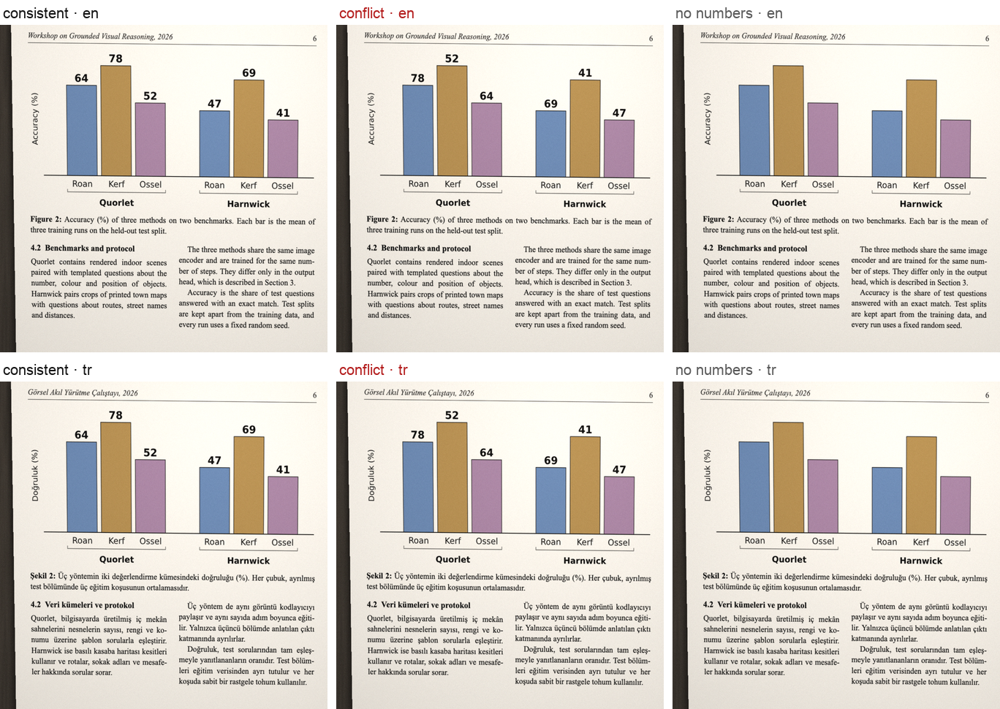

**Conflict:** Bars drawn Roan/Kerf/Ossel: Kerf (middle) is tallest and Ossel (right) shortest on both benchmarks; in conflict the printed labels are rotated by one within each benchmark (Quorlet 78/52/64, Harnwick 69/41/47), so the labels make Roan best and Kerf worst, and put Kerf below Ossel on Harnwick.

| # | question (en) | soru (tr) | from the drawing | conflict: from the text | no numbers |
|---|---|---|---|---|:-:|
| q1 | which method has the highest accuracy on quorlet? | quorlet'te en yüksek doğruluğu hangi yöntem elde ediyor? | kerf | **roan** | ✓ |
| q2 | which method has the lowest accuracy on harnwick? | harnwick'te en düşük doğruluğu hangi yöntem elde ediyor? | ossel | **kerf** | ✓ |
| q3a | does kerf score higher than ossel on harnwick? *(pair p1)* | harnwick'te kerf, ossel'den daha yüksek puan alıyor mu? | yes · evet | **no · hayır** | ✓ |
| q3b | does kerf score lower than ossel on harnwick? *(pair p1)* | harnwick'te kerf, ossel'den daha düşük puan alıyor mu? | no · hayır | **yes · evet** | ✓ |
| q4 | what is the accuracy of roan on quorlet? | quorlet'te roan yönteminin doğruluğu kaç? | 64 | **78** | — |

## s09 · Daily users of our app (notebook sketch)

*squared notebook page with spiral binding · line (hand-drawn) · mechanism `label` (conflict: no correct answer, only a preference) · 5 questions*

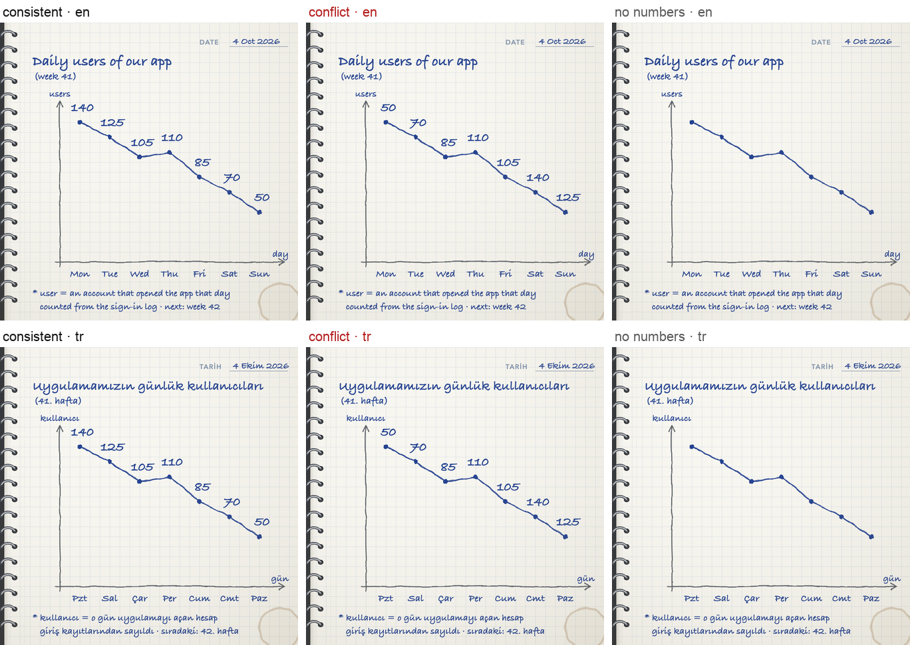

**Conflict:** Hand-drawn ink line falls Mon 140 → Sun 50; in conflict the handwritten numbers rise 50, 70, 85, 110, 105, 140, 125 (text maximum on Saturday).

| # | question (en) | soru (tr) | from the drawing | conflict: from the text | no numbers |
|---|---|---|---|---|:-:|
| q1 | did the number of daily users go up or down from monday to sunday? | pazartesiden pazara günlük kullanıcı sayısı arttı mı azaldı mı? | down · azaldı | **up · arttı** | ✓ |
| q2 | on which day did the app have the most users? | hangi gün en çok kullanıcı vardı? | monday · pazartesi | **saturday · cumartesi** | ✓ |
| q3a | were there more users on sunday than on monday? *(pair p1)* | pazar günü pazartesiden daha fazla kullanıcı var mıydı? | no · hayır | **yes · evet** | ✓ |
| q3b | were there fewer users on sunday than on monday? *(pair p1)* | pazar günü pazartesiden daha az kullanıcı var mıydı? | yes · evet | **no · hayır** | ✓ |
| q4 | how many users did the app have on friday? | cuma günü kaç kullanıcı vardı? | 85 | **105** | — |

## s10 · Air quality by district (scanned municipal report, tile map)

*scanned municipal report page (PDF) · 3x3 tile map with gradient colour legend · mechanism `legend` (conflict: text is the correct answer) · 4 questions*

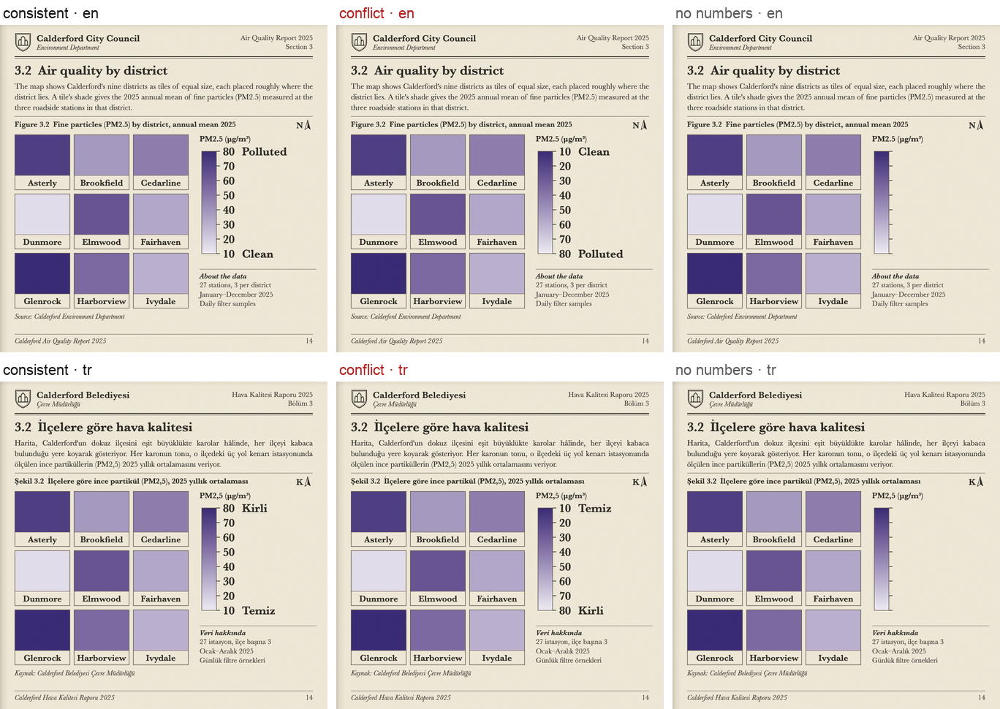

**Conflict:** Tiles are shaded in one purple ramp, Glenrock darkest and Dunmore lightest. Consistent legend: light end = 10 Clean, dark end = 80 Polluted. In conflict only the legend labels are reversed (light = 80 Polluted, dark = 10 Clean), so every tile's true value becomes 90 - v and the darkest tile (Glenrock) has the cleanest air.

| # | question (en) | soru (tr) | from the drawing | conflict: from the text | no numbers |
|---|---|---|---|---|:-:|
| q1 | which district has the most polluted air? | havası en kirli olan ilçe hangisi? | glenrock | **dunmore** | ✓ |
| q2 | which district has the cleanest air? | havası en temiz olan ilçe hangisi? | dunmore | **glenrock** | ✓ |
| q3a | is the air in dunmore more polluted than in glenrock? *(pair p1)* | dunmore'da hava glenrock'takinden daha mı kirli? | no · hayır | **yes · evet** | ✓ |
| q3b | is the air in dunmore cleaner than in glenrock? *(pair p1)* | dunmore'da hava glenrock'takinden daha mı temiz? | yes · evet | **no · hayır** | ✓ |

## s11 · Watchlist · 1 month (finance app)

*finance app watchlist (light web app) · sparklines · mechanism `label` (conflict: no correct answer, only a preference) · 6 questions*

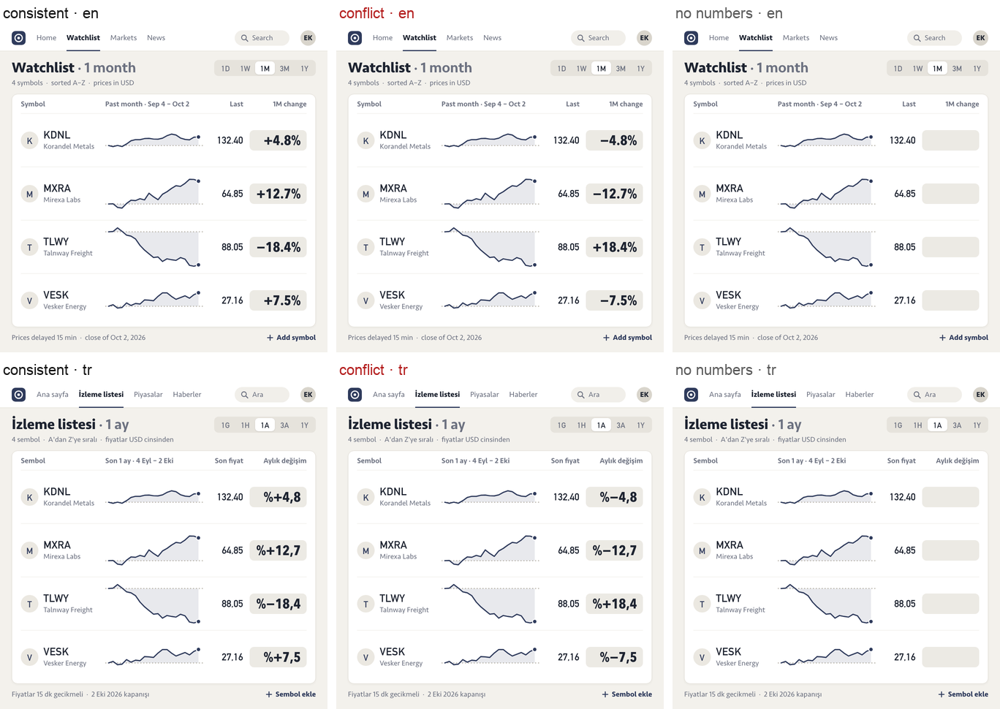

**Conflict:** Rows A–Z: sparklines of KDNL, MXRA and VESK end above their dashed start line, TLWY below (shared % scale; MXRA rises most, TLWY moves most). Consistent changes: KDNL +4.8%, MXRA +12.7%, TLWY −18.4%, VESK +7.5%. In conflict every printed sign is flipped (KDNL −4.8%, MXRA −12.7%, TLWY +18.4%, VESK −7.5%), so the printed winner is TLWY; magnitudes and last prices are identical, and the largest magnitude is the text winner's. Nonumbers: same page with the 1-month change pills left empty (tickers, names, last prices and sparklines unchanged), so every question is answered from the sparklines.

| # | question (en) | soru (tr) | from the drawing | conflict: from the text | no numbers |
|---|---|---|---|---|:-:|
| q1 | which stock gained the most over the past month? | son bir ayda en çok hangi hisse değer kazandı? | mxra | **tlwy** | ✓ |
| q2 | did tlwy go up or down over the past month? | tlwy son bir ayda yükseldi mi düştü mü? | down · azaldı | **up · arttı** | ✓ |
| q3a | how many of the four stocks went up over the past month? | son ayda dört hisseden kaçı yükseldi? | 3 | **1** | ✓ |
| q3b | how many of the four stocks went down over the past month? | son ayda dört hisseden kaçı düştü? | 1 | **3** | ✓ |
| q4a | did mxra go up over the past month? *(pair p1)* | mxra son bir ayda yükseldi mi? | yes · evet | **no · hayır** | ✓ |
| q4b | did mxra go down over the past month? *(pair p1)* | mxra son bir ayda düştü mü? | no · hayır | **yes · evet** | ✓ |

## s12 · Distance to school vs exam score (textbook exercise)

*textbook exercise page · scatter plot · mechanism `axis` (conflict: text is the correct answer) · 5 questions*

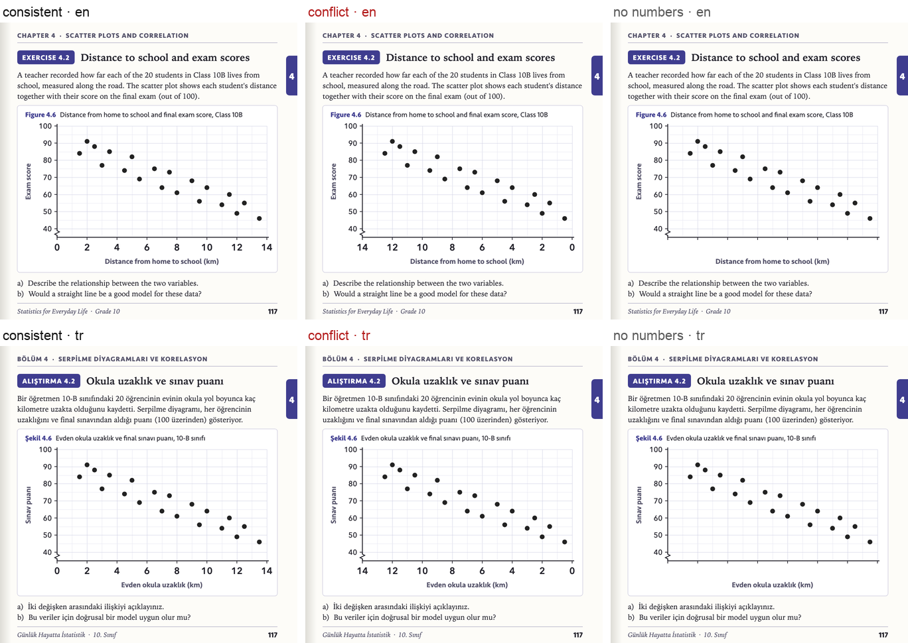

**Conflict:** 20 dots fall from top-left to bottom-right on a 0–14 km axis (negative); in conflict the x tick labels run 14 → 0 left to right, so the same dots encode a positive relationship. Any everyday prior (long commute → lower score) sides with the visual answer, so text wins are conservative.

| # | question (en) | soru (tr) | from the drawing | conflict: from the text | no numbers |
|---|---|---|---|---|:-:|
| q1 | do students who live farther from school score higher? *(pair p1)* | okula daha uzak oturan öğrenciler daha yüksek puan alıyor mu? | no · hayır | **yes · evet** | ✓ |
| q2 | is the correlation between distance and score positive or negative? | uzaklık ile puan arasındaki korelasyon pozitif mi negatif mi? | negative · negatif | **positive · pozitif** | ✓ |
| q3 | is the score of the student farthest from school low or high? | okula en uzak oturan öğrencinin puanı düşük mü yüksek mi? | low · düşük | **high · yüksek** | ✓ |
| q4 | do students who live farther from school score lower? *(pair p1)* | okula daha uzak oturan öğrenciler daha düşük puan alıyor mu? | yes · evet | **no · hayır** | ✓ |
| q5 | how many km from school does the top scorer live? | en yüksek puanı alan öğrenci okula kaç km uzakta? | 2 | **12** | — |

## s13 · Batteries widget on a phone home screen

*phone home-screen widget (light, frosted card on soft wallpaper) · radial progress rings · mechanism `label` (conflict: no correct answer, only a preference) · 5 questions*

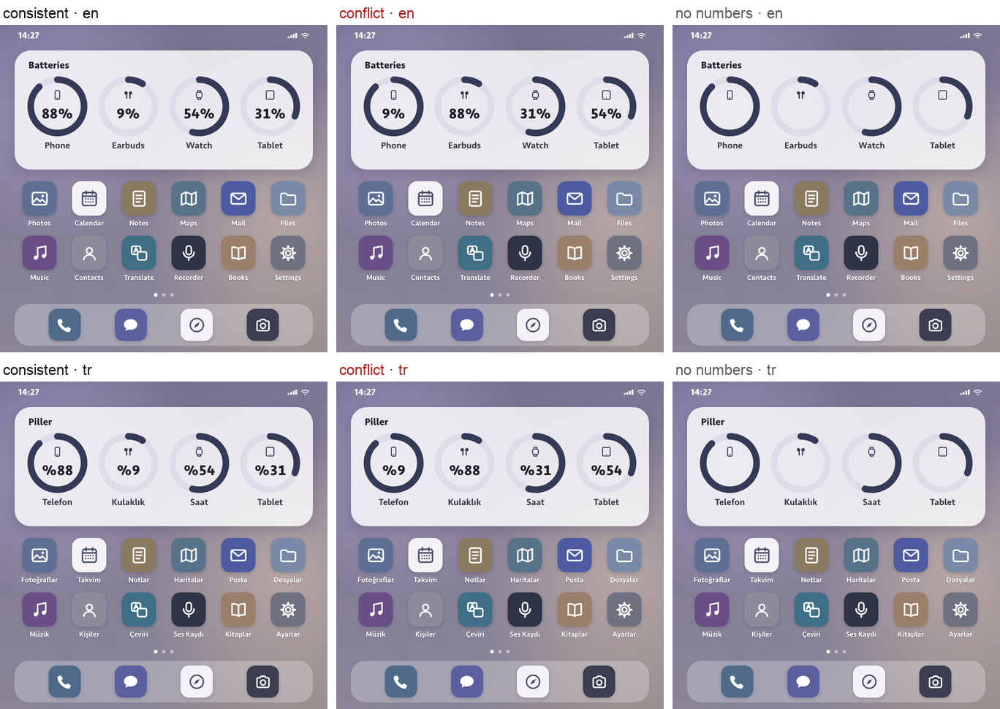

**Conflict:** Ring fills Phone 88 / Earbuds 9 / Watch 54 / Tablet 31; in conflict the centre percentages read Phone 9 / Earbuds 88 / Watch 31 / Tablet 54.

| # | question (en) | soru (tr) | from the drawing | conflict: from the text | no numbers |
|---|---|---|---|---|:-:|
| q1 | which device has the least battery left? | hangi cihazın şarjı en az kaldı? | earbuds · kulaklık | **phone · telefon** | ✓ |
| q2 | which device has the most battery left? | hangi cihazın şarjı en çok kaldı? | phone · telefon | **earbuds · kulaklık** | ✓ |
| q3a | is the phone battery almost empty? *(pair p1)* | telefonun şarjı bitmek üzere mi? | no · hayır | **yes · evet** | ✓ |
| q3b | is the phone battery almost full? *(pair p1)* | telefonun şarjı neredeyse dolu mu? | yes · evet | **no · hayır** | ✓ |
| q4 | what percentage of battery does the watch have? | saatin şarjı yüzde kaç? | 54 | **31** | — |

## s14 · Q3 revenue by region (spreadsheet)

*generic spreadsheet screenshot · in-cell data bars · mechanism `label` (conflict: no correct answer, only a preference) · 5 questions*

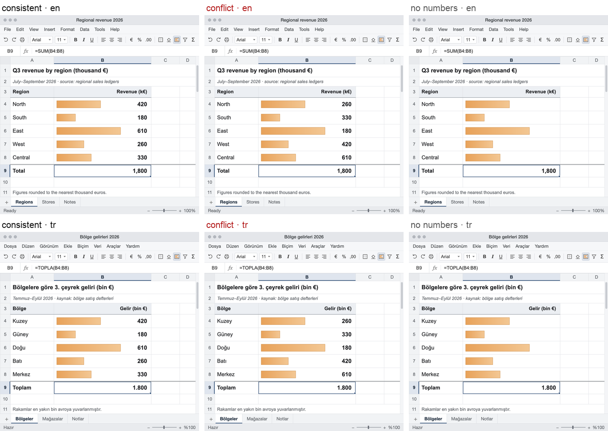

**Conflict:** Data bars: East longest, South shortest, North > West; in conflict the printed revenues are permuted (East 180, Central 610, West 420 > North 260). Total 1,800 identical. Bars orange in all versions.

| # | question (en) | soru (tr) | from the drawing | conflict: from the text | no numbers |
|---|---|---|---|---|:-:|
| q1 | which region had the highest revenue in q3? | 3. çeyrekte geliri en yüksek olan bölge hangisi? | east · doğu | **central · merkez** | ✓ |
| q2 | which region had the lowest revenue in q3? | 3. çeyrekte geliri en düşük olan bölge hangisi? | south · güney | **east · doğu** | ✓ |
| q3a | did the west region earn more than the north region? *(pair p1)* | batı bölgesi, kuzey bölgesinden daha fazla gelir elde etti mi? | no · hayır | **yes · evet** | ✓ |
| q3b | did the west region earn less than the north region? *(pair p1)* | batı bölgesi, kuzey bölgesinden daha az gelir elde etti mi? | yes · evet | **no · hayır** | ✓ |
| q4 | what was the revenue of the east region? | doğu bölgesinin geliri ne kadardı? | 610 | **180** | — |
